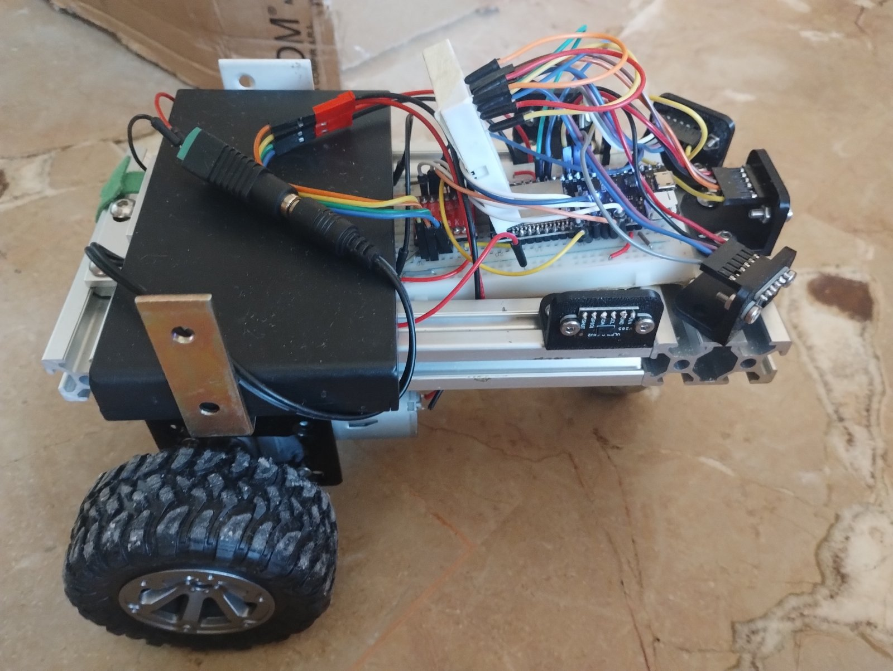
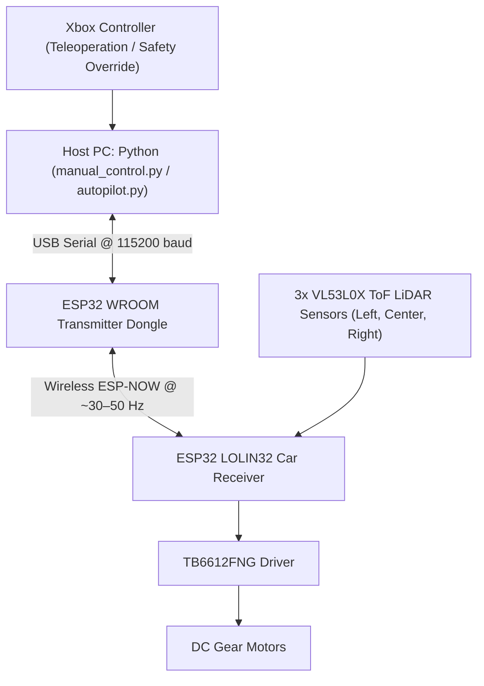
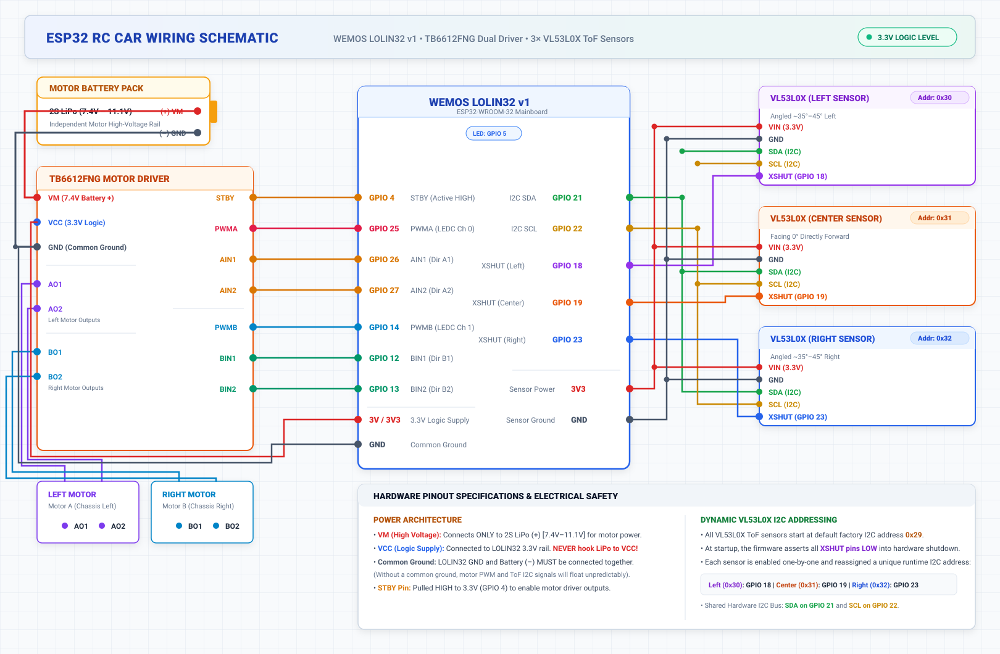

# ESP32 Machine Learning Autonomous RC Car

This is a behavioral cloning (imitation learning) RC car project. You drive the car around a walled track with an Xbox controller while it streams live Time-of-Flight LiDAR readings back to your PC. From there, a Random Forest classifier learns from your driving and takes over the steering on its own.

The result is an autonomous car that learns from the track design and the driver's piloting patterns.



---

## How It Works

Instead of running ML inference directly on the ESP32, the car offloads the heavy lifting to a host PC and uses **ESP-NOW** for low-latency wireless telemetry and motor commands:



1. **Car Node (WEMOS LOLIN32 v1):** Reads three forward-facing VL53L0X Time-of-Flight distance sensors over I2C, sends telemetry packets over ESP-NOW, and drives the motors through a TB6612FNG dual H-bridge.
2. **Transmitter Dongle (ESP32 WROOM DevKit v1):** Plugs into your PC over USB and acts as a two-way wireless bridge—forwarding driving commands to the car and streaming sensor telemetry back to Python.
3. **Data Collection (`manual_control.py`):** Logs synchronized distance readings `[dist_left_mm, dist_center_mm, dist_right_mm]` alongside your driving labels (`FORWARD`, `FORWARD_LEFT`, `FORWARD_RIGHT`) whenever you hold `[A]` on the Xbox controller.
4. **Model Training (`train.py`):** Trains a `scikit-learn` Random Forest classifier on those distance readings and saves the trained model to `pilot_model.pkl`.
5. **Autopilot (`autopilot.py`):** Runs live telemetry through the trained model at ~30 Hz and sends steering and throttle commands back to the car, with built-in collision braking and manual overrides.

---

## Parts List

* **Microcontrollers:**
  * **Car Receiver:** WEMOS LOLIN32 v1 (ESP32-WROOM-32)
  * **Transmitter Dongle:** ESP32 WROOM DevKit v1
* **Motor Driver:** TB6612FNG Dual H-Bridge Driver
* **Sensors:** 3x VL53L0X Time-of-Flight (ToF) Laser Distance Sensors
  * **Left:** ~35°–45° angled outward
  * **Center:** 0° facing straight ahead
  * **Right:** ~35°–45° angled outward
* **Chassis & Motors:** 2WD / 4WD robot chassis with DC gear motors
* **Power:**
  * **Motors:** Dedicated battery pack (e.g., 2S LiPo / 7.4V) wired to TB6612FNG `VM`
  * **Car Logic:** 5V power bank or 3.7V LiPo connected to the LOLIN32
* **Controller:** Xbox Wireless / Wired Controller (USB or Bluetooth)

---

## Wiring & Pinout



### 1. TB6612FNG Motor Driver -> ESP32 LOLIN32 v1

| TB6612FNG Pin | LOLIN32 v1 Pin | Power / Motor | Description |
| :--- | :--- | :--- | :--- |
| **VM** | — | Battery **(+)** (6V–12V) | Motor power rail |
| **VCC** | **3V** (3.3V) | — | Driver logic supply |
| **GND** | **GND** | Battery **(–)** | **Common Ground** (ESP32 GND tied to battery negative) |
| **STBY** | **GPIO 4** | — | Standby enable (`HIGH` = Active) |
| **PWMA** | **GPIO 25** | — | Motor A (Left) speed (LEDC Ch 0 PWM) |
| **AIN1 / AIN2**| **GPIO 26 / 27** | — | Motor A direction |
| **PWMB** | **GPIO 14** | — | Motor B (Right) speed (LEDC Ch 1 PWM) |
| **BIN1 / BIN2**| **GPIO 12 / 13** | — | Motor B direction |
| **AO1 / AO2** | — | Left Motor | Motor A terminals |
| **BO1 / BO2** | — | Right Motor | Motor B terminals |

---

### 2. 3x VL53L0X ToF Distance Sensors -> LOLIN32 v1

All three sensors share the same I2C bus (`SDA` / `SCL`). On boot, the LOLIN32 toggles each sensor's `XSHUT` pin to assign them unique I2C addresses:

| Sensor | I2C Address | LOLIN32 `XSHUT` Pin | Shared I2C Pins |
| :--- | :--- | :--- | :--- |
| **Left Sensor** | `0x30` | **GPIO 18** | **SDA:** GPIO 21<br>**SCL:** GPIO 22<br>**VIN:** 3.3V<br>**GND:** GND |
| **Center Sensor** | `0x31` | **GPIO 19** | |
| **Right Sensor** | `0x32` | **GPIO 23** | |

---

## Running the Pipeline

### 1. Collect Driving Data

Plug the transmitter dongle into your PC, connect your Xbox controller, and start driving:

```bash
uv run manual_control.py
```

* **Controls:**
  * **Left Stick X:** Steering (`-1.0` full left to `+1.0` full right)
  * **Left Stick Y / Triggers:** Throttle (`RT` forward, `LT` reverse)
  * **`B` Button:** Emergency Brake / Instant Stop
  * **Hold `[A]` Button:** Record distance telemetry and direction labels at 20 Hz
* **Output:** `track_data.csv` (`timestamp_iso`, `timestamp_epoch`, `dist_left_mm`, `dist_center_mm`, `dist_right_mm`, `steer`, `throttle`, `direction`).

---

### 2. Train the Model

Train the Random Forest classifier on the three distance sensor readings (`dist_left_mm`, `dist_center_mm`, `dist_right_mm`):

```bash
uv run python train.py
```

* **Features:** Distance sensor readings only (timestamps, steer, and throttle are left out).
* **Target Classes:** `FORWARD`, `FORWARD_LEFT`, `FORWARD_RIGHT`
* **Validation:** 5-fold stratified cross-validation plus a held-out test split (~82–85% test accuracy).
* **Output:** Saves the model artifact to **`pilot_model.pkl`**.

---

### 3. Autonomous Driving

Let the trained model take the wheel:

```bash
uv run python autopilot.py
```

* **Live Inference:** Evaluates incoming sensor telemetry at 30 Hz using `pilot_model.pkl` to pick the next driving action.
* **Actuation Mapping:**
  * `FORWARD`: Straight cruise (`steer: 0.00`, `throttle: 0.85`)
  * `FORWARD_LEFT`: Arcing left turn (`steer: -0.55`, `throttle: 0.77`)
  * `FORWARD_RIGHT`: Arcing right turn (`steer: +0.55`, `throttle: 0.77`)
* **Safety Overrides:**
  * **Emergency Obstacle Braking:** If `dist_center_mm < 140 mm`, the motors cut immediately to avoid hitting a wall.
  * **Dead-Man Switch:** Pressing **`B`** on the Xbox controller triggers an instant emergency brake.
  * **Manual Takeover:** Moving the left stick immediately overrides the autopilot.
  * **Stale Telemetry Failsafe:** Stops the car if telemetry drops out for more than 1.0 s.

#### Offline Simulation Mode
You can also test model predictions against recorded track data without connecting the car:

```bash
uv run python autopilot.py --simulate
```

---

## Flashing Firmware with PlatformIO

There are two firmware environments defined in [`platformio.ini`](platformio.ini):

### 1. Transmitter Dongle (`wroom_transmitter`)
Plugs into your PC over USB, reads serial commands from Python, and broadcasts them over ESP-NOW:

```bash
pio run -e wroom_transmitter -t upload -t monitor
```

### 2. Car Receiver (`lolin32_car`)
Rides on the chassis and talks to the TB6612FNG driver and the three VL53L0X ToF sensors:

```bash
pio run -e lolin32_car -t upload -t monitor
```
